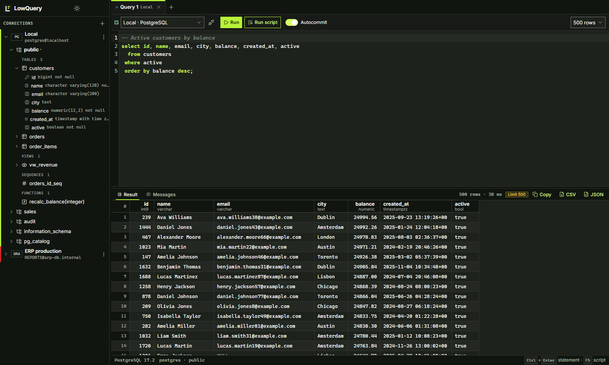

<p align="center">
  
</p>

<h1 align="center">LowQuery</h1>

<p align="center">
  A light SQL client for people who work with many databases.<br>
  Each one through its own native driver, the way it is meant to be used.
</p>

<p align="center">
  <a href="https://github.com/LowBloat/LowQuery/releases/latest"></a>
  <a href="https://github.com/LowBloat/LowQuery/actions/workflows/ci.yml"></a>
  <a href="LICENSE"></a>
</p>

<p align="center">
  <a href="https://github.com/LowBloat/LowQuery/releases/latest">Download the app</a>
  · <a href="#get-started">Get started</a>
  · <a href="#how-it-works">How it works</a>
  · <a href="CONTRIBUTING.md">Contribute</a>
</p>

---

LowQuery is an **open-source desktop SQL client** for Windows, Linux and macOS. It currently supports **PostgreSQL** and **Oracle**, and treats each one as itself: PostgreSQL through its extended protocol with server-side row limits, Oracle through Oracle's official pure-Rust driver with **no Oracle Client or Instant Client to install**. The app is built with Tauri and Rust, so it starts fast and stays small.



*A PostgreSQL query in LowQuery, with the schema browser on the left and the result grid below the editor.*

## Why LowQuery?

- **Native per database.** No ODBC or JDBC layer in the middle. Types, transactions, scripts and errors follow each engine's own rules.
- **Exact values.** NUMERIC and NUMBER keep every digit, dates keep their precision, and infinite dates, intervals, arrays and ranges show up the way the server writes them.
- **Large tables are safe to open.** The row limit is applied by the server, so `SELECT *` on a big table does not pull it across the network.
- **Oracle without the client install, and with yours when you have it.** No Oracle Client is required, yet LowQuery reads the `tnsnames.ora` your machine already uses: from `TNS_ADMIN`, `ORACLE_HOME`, the Oracle homes in the Windows registry or an Instant Client on `PATH`. Pick an alias, import many at once, or connect by service name, SID, descriptor or Easy Connect, as SYSDBA when needed.
- **Passwords stay in your keychain.** Profiles are a plain JSON file; passwords live in Windows Credential Manager, macOS Keychain or Linux Secret Service.
- **Errors you can act on.** Native codes (SQLSTATE, ORA-NNNNN), detail and hint, with the failing token underlined in the editor.

| Writing queries | Reading results |
| --- | --- |
| CodeMirror editor with each engine's dialect | Virtualized grid for thousands of rows |
| Autocompletion from the schema browser | Local sorting, resizable columns, keyboard navigation |
| Run the statement under the cursor, a selection or the whole script | Value viewer with formatted JSON |
| PL/SQL blocks with `/`, PostgreSQL `$$` bodies | Copy as TSV, export to CSV or JSON |
| One session per tab, autocommit or Commit/Rollback | `RAISE NOTICE` and `DBMS_OUTPUT` in the Messages tab |

## Get started

### Download

The [latest release](https://github.com/LowBloat/LowQuery/releases/latest) includes these builds:

| Platform | Available formats |
| --- | --- |
| Windows x64 | Setup `.exe`, `.msi`, portable `.zip` |
| Linux x64 | `.AppImage`, `.deb`, `.rpm`, portable `.tar.gz` |
| macOS (Apple Silicon and Intel) | Universal `.dmg` |

**Verify a download.** Each release has `.sha256` files, a `SHA256SUMS` file, an SPDX software bill of materials (`*-sbom.spdx.json`) and GitHub build provenance attestations. With the [GitHub CLI](https://cli.github.com/):

```bash
gh attestation verify LowQuery-<version>-linux-x64.AppImage --repo LowBloat/LowQuery
```

**Updates.** Installed copies on Windows, macOS and AppImage update themselves: LowQuery checks for a new release in the background, shows what changed and installs it when you choose **Install and restart**. Updates are signed and verified before installation. `.deb`, `.rpm` and portable copies are told when a new version is out and link to the download.

**First launch on Windows and macOS.** The installers are not code-signed yet, so the system warns on first launch:

- **Windows:** SmartScreen shows "Windows protected your PC". Choose **More info → Run anyway**.
- **macOS:** Gatekeeper may say the app "is damaged" or "cannot be opened". Right-click LowQuery in Applications and choose **Open**, or run `xattr -dr com.apple.quarantine /Applications/LowQuery.app` once.

### Run your first query

1. Open LowQuery and choose **New connection**.
2. Pick **PostgreSQL** or **Oracle**, fill in the server and user, and choose **Test connection**. For Oracle, **TNS alias** lists the aliases from the detected Oracle client; **Import from tnsnames.ora** in the sidebar creates one connection per alias.
3. Save. The connection appears in the sidebar; expand it to browse schemas, tables and columns.
4. Type SQL in the editor and press **Ctrl+Enter** (⌘+Enter on macOS) to run the statement under the cursor, or **Ctrl+Shift+Enter** / **F5** to run the whole script.

| Shortcut | Action |
| --- | --- |
| Ctrl+Enter | Run the selection or the statement under the cursor |
| Ctrl+Shift+Enter, F5 | Run the script, one statement at a time |
| Ctrl+T / Ctrl+W | New tab / close tab |
| F2 on a tab, double-click | Rename the tab |
| Ctrl+C / Ctrl+Shift+C in the grid | Copy the value / the row |
| Enter in the grid | Open the value viewer |

## How it works

| Topic | PostgreSQL | Oracle |
| --- | --- | --- |
| Driver | [`tokio-postgres`](https://crates.io/crates/tokio-postgres), extended protocol | [`oracledb`](https://github.com/oracle/rust-oracledb), Oracle's thin driver in pure Rust |
| Row limit | Portal executed with `max_rows` | `prefetch_rows` and fetch size sized from the limit |
| Values | Binary format decoded per type into server-style text | Per-type formatting for NUMBER, DATE, TIMESTAMP (with time zone), RAW/BLOB, CLOB, JSON, VECTOR and intervals |
| Server messages | `NOTICE`/`WARNING` | `DBMS_OUTPUT` |
| Cancel | Server cancel protocol | Not available in the driver yet; scripts stop before the next statement |
| Network configuration | Host, port and database in the profile | `tnsnames.ora` found through `TNS_ADMIN`, `ORACLE_HOME`, registered Oracle homes or Instant Client on `PATH`, or a folder you pick; `IFILE`, `NAMES.DEFAULT_DOMAIN` and Latin-1 files are supported |
| Encryption | `disable`, `prefer`, `require`, `verify-full` | TLS (TCPS) through a descriptor or Easy Connect string |
| Scripts | `;`, `$$` and `$tag$` bodies, nested comments, `E''` strings | `;` for SQL, `/` for PL/SQL, `q'[...]'` strings |

Connection profiles are stored in `connections.json` in the user configuration folder (`%APPDATA%\LowBloat\LowQuery\config` on Windows, `~/Library/Application Support/dev.LowBloat.LowQuery` on macOS, `~/.config/lowquery` on Linux). Open query tabs and their SQL are restored on the next start.

Read [docs/ARCHITECTURE.md](docs/ARCHITECTURE.md) for the code layout and how a new database engine is added.

## Build from source

Install [Bun](https://bun.sh), the stable [Rust toolchain](https://rustup.rs/) and the [Tauri prerequisites](https://v2.tauri.app/start/prerequisites/).

```bash
git clone https://github.com/LowBloat/LowQuery.git
cd LowQuery
bun install
bun run tauri dev
```

`bun run tauri build --no-bundle` builds the app for your system. Installers are also signed for the updater, so a full `bun run tauri build` needs the signing key; without it, disable that step with `bun run tauri build -c '{"bundle":{"createUpdaterArtifacts":false}}'`. To work only on the interface, `bun run dev` serves it at http://localhost:1420 with a development mock backend.

## Roadmap

- Interrupt a running Oracle call when the driver exposes it.
- Bind variables (`:name`, `$1`) with a value dialog.
- Fetch more rows on demand without running the query again.
- Execution plans (`EXPLAIN`, `DBMS_XPLAN`).
- Query history per connection.
- Editing data in the grid.
- More engines: SQL Server, MySQL/MariaDB and SQLite.

Suggestions and database requests are welcome in the [issue forms](https://github.com/LowBloat/LowQuery/issues/new/choose).

## Contributing

Bug reports, database support and pull requests are welcome. See [CONTRIBUTING.md](CONTRIBUTING.md) for setup and checks, [SECURITY.md](SECURITY.md) to report a vulnerability privately, and the [code of conduct](CODE_OF_CONDUCT.md).

## License

LowQuery is released under the [GNU Affero General Public License v3.0 only](LICENSE).
